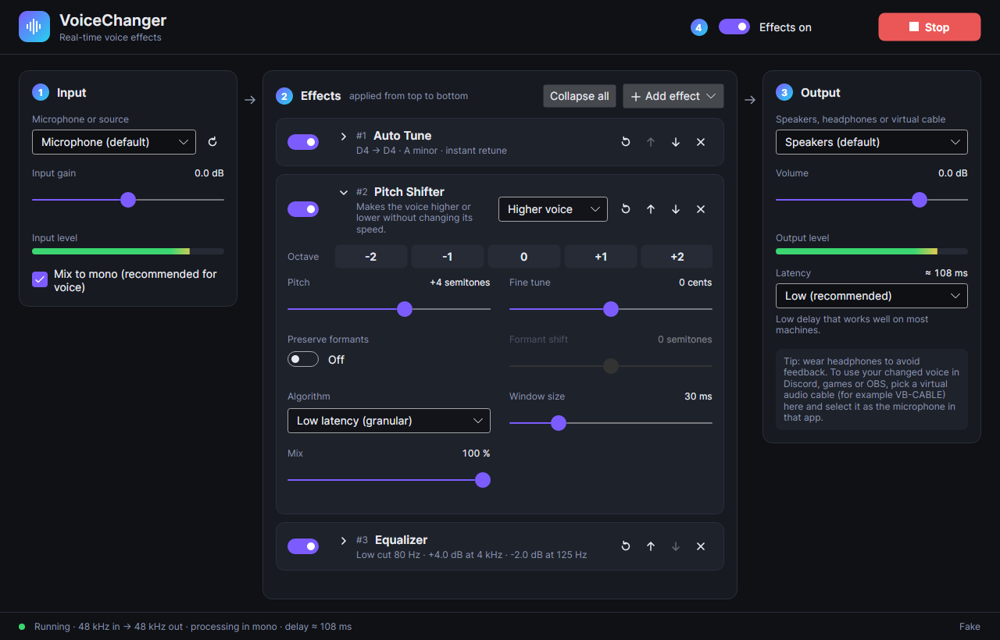
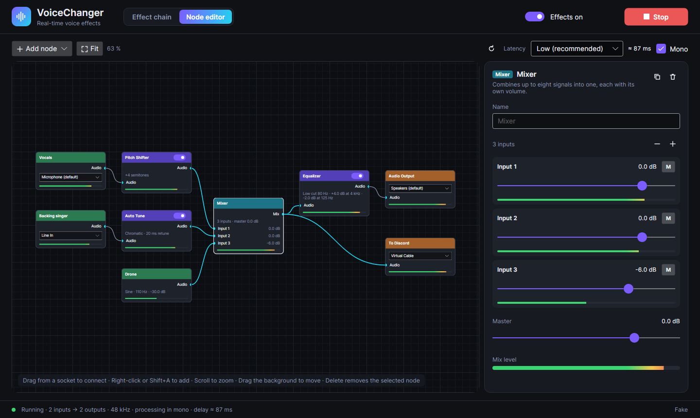
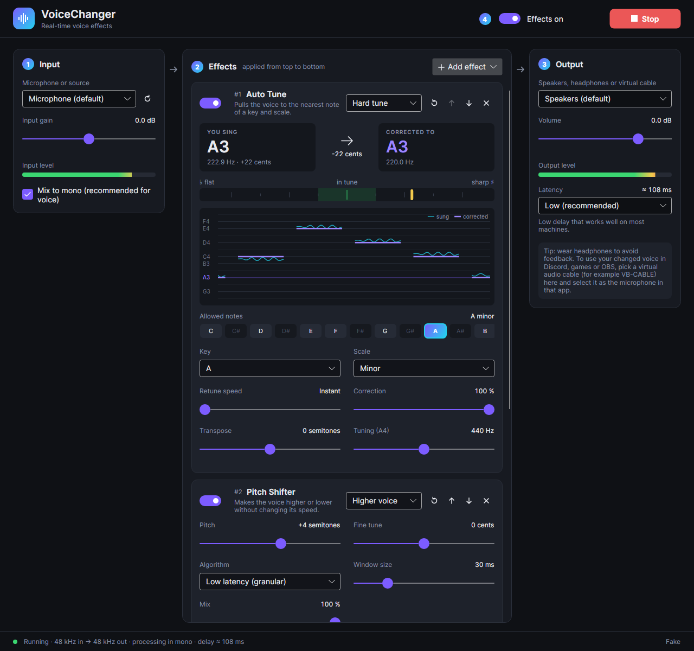

# VoiceChanger

A real-time voice changer for Windows written in C#. Pick a microphone, choose and configure effects,
pick an output, and hear the result live with low delay.



## Features

- **Live processing with low delay.** Audio goes from the microphone to the output in roughly 40–70 ms,
  depending on the latency setting and the effects in use.
- **Any input and output device.** Microphones, line inputs, speakers, headphones and virtual audio
  cables. If the two devices use different sample rates, the app converts between them, and it
  compensates for the small clock difference between two separate devices, so the delay stays the same
  and you don't get periodic crackles.
- **Effect chain.** Add, remove and reorder effects. Each effect has its own on/off switch, a preset
  list and a reset button. A master switch bypasses all of them at once. Switching makes no clicks.
- **Equalizer:** ten bands from 31 Hz to 16 kHz, adjustable bandwidth, low cut and high cut filters,
  output gain and a live frequency response curve. Presets: Bass boost, Treble boost, Voice clarity,
  Warm, Telephone, AM radio, Megaphone, Muffled.
- **Pitch shifter:** up to two octaves up or down. The **Octave** buttons (−2, −1, 0, +1, +2) jump
  straight to whole octaves, and the **Pitch** slider adds single semitones; its label reads e.g.
  "+1 octave +3 semitones". There is also fine tuning in cents, an adjustable window size and a
  dry/wet mix. It has two algorithms:
  - *Low latency (granular)*: shifts the sound in the time domain and aligns each grain to the waveform
    to reduce warble. Delay is about half the window size.
  - *High quality (phase vocoder)*: a phase-locked phase vocoder followed by resampling. It sounds
    smoother for large shifts and adds more delay.

  **Preserve formants** keeps the character of your voice when you shift it, so an octave up sounds
  like you singing higher rather than a chipmunk, and an octave down sounds like you rather than a
  monster. It works by estimating the spectral envelope (the formants) of every frame and putting it
  back where it was after the harmonics have moved. With it on, **Formant shift** moves the formants
  on their own: negative values sound like a bigger person, positive values like a smaller one,
  without changing the pitch. Formant preservation always uses the high quality algorithm, so it adds
  about 20 ms more delay than the low latency one.

  Presets: Higher voice, Lower voice, Chipmunk, Deep, Monster, Harmony, Detune, Natural octave up,
  Natural octave down, Bigger voice, Smaller voice.
- **Auto Tune:** detects the pitch of your voice and pulls it to the nearest note of a key and scale.
  See [Auto Tune](#auto-tune) below.
- **Node editor** for anything beyond one microphone and one chain: several inputs at once, a
  **mixer** to combine them, effects anywhere in between, and several outputs. See
  [Node editor](#node-editor) below.
- Input and output **level meters**, input gain and output volume.
- **Remembers your settings**: devices, effects, every effect setting, the node graph and the latency
  preset.

## How to use it

1. **Input:** choose your microphone (step 1).
2. **Effects:** adjust the effects in the middle column (step 2). Use **Add effect** to add more, the
   arrows to change the order, and ✕ to remove one. Effects run from top to bottom.
3. **Output:** choose where the changed voice goes (step 3).
4. **On/off:** press **Start** (or Ctrl+Enter) to begin processing. Use **Effects on/off** at the top
   (step 4) to compare your normal voice with the changed one, or the switch on each effect card to turn
   that effect on or off.

Tips:

- **Wear headphones.** Your speakers feed back into the microphone.
- **To use the voice in Discord, games, Zoom or OBS**, install a virtual audio cable such as
  [VB-CABLE](https://vb-audio.com/Cable/). Select *CABLE Input* as the **output** in VoiceChanger, then
  select *CABLE Output* as the **microphone** in the other app.
- **Collapse effects to make room.** Click an effect's name (or the arrow next to it) to fold the
  card down to a one-line summary of its settings, e.g. "+1 octave · formants kept" or, for
  Auto Tune while you sing, "D4 → D4 · A minor · instant retune". **Collapse all** / **Expand all**
  in the Effects header folds or opens every card. Collapsed cards stay collapsed the next time you
  start the app.
- **Double-click any effect slider** to reset it to its default value.
- **If you hear crackles or dropouts**, choose a safer latency setting under Output. The status bar
  counts dropouts while audio is running.
- Settings are saved to `%APPDATA%\VoiceChanger\settings.json`.

## Node editor



Switch from **Effect chain** to **Node editor** at the top of the window to build the signal path out
of nodes and wires, like the shader editor in Blender. The first time you open it, your current chain
becomes the starting graph: *Audio Input → your effects → Mixer → Audio Output*.

Nodes:

| Node | What it does |
| --- | --- |
| Audio Input | Audio from a microphone, line input or any other recording device. Add one per device to use several at once. Has its own gain. |
| Tone Generator | A sine, triangle, sawtooth or square wave, or white noise. Handy for testing a patch, or as a drone under your voice. |
| Pitch Shifter, Auto Tune, Equalizer | The effects, with the same settings and presets as in the chain. The switch in the node's header turns it on or off. |
| Mixer | Combines 2 to 8 signals. Each input has a volume fader, a mute button and a level meter, and there is a master volume. |
| Audio Output | Plays the signal on a device. Add one per device to play on several at once, e.g. your headphones and a virtual cable. Has its own volume. |

Working with nodes:

- **Connect:** drag from a socket on the right of a node (an output) to a socket on the left of
  another (an input), or the other way round. An output can feed any number of inputs; an input takes
  one wire, so a new wire replaces the old one. Wires that would form a loop are refused.
- **Disconnect or re-route:** drag a wire away from the input it is plugged into, and drop it on
  another input or on empty space.
- **Add nodes:** **Add node** in the toolbar, right-click the canvas, or press **Shift+A**.
- **Select** a node by clicking it. The inspector on the right shows all its settings, including the
  full effect editors, and lets you give the node a name (e.g. "Guitar").
- **Move** a node by dragging it. Drag the background (or use the middle mouse button) to move
  around, and scroll to zoom. **Fit** (or **Home**) shows the whole graph.
- **Delete** removes the selected node, **Ctrl+D** duplicates it. Right-click a node for the same.
- **Effects on/off**, **Start/Stop**, the latency setting and **Mono** work the same as in the chain.
  Editing the graph while audio is running takes effect immediately with a short fade; adding,
  removing or changing a *device* briefly restarts the audio.

How the devices are kept in sync: the first Audio Output node's device is the master clock. Each time it
needs audio, the app pulls the latest audio from every input device, runs the whole graph and hands
the result to the other output devices. Every other device runs on its own clock, so each one gets its
own sample rate conversion and drift compensation, the same way the chain connects its two devices.

Limitations:

- When signals that went through effects with different delays meet in a mixer, they are not
  re-aligned. For example, a dry voice mixed with the same voice through the phase vocoder is offset by
  about 20 ms.
- An Audio Input node that isn't connected to anything still opens its device, so its level meter keeps
  working.

## Auto Tune



Add it with **Add effect → Auto Tune**. While audio is running the card shows:

- **You sing / Corrected to:** the note you are singing, its frequency and how many cents it is off,
  and the note it is being pulled to, with the size of the correction in between.
- **Tuner:** how far your voice is from the target note, from −50 cents (flat) to +50 cents (sharp).
  The green zone is within ±10 cents.
- **Pitch graph:** the last five seconds of your sung pitch (cyan) and the corrected pitch (purple),
  drawn on note lines. The notes of the selected scale are labelled, and the key's root note is
  highlighted.
- **Allowed notes:** the notes of the selected key and scale. The target note is filled in, and the
  note you are closest to is outlined.

Settings:

| Setting | What it does |
| --- | --- |
| Key and Scale | The notes your voice is pulled to. *Chromatic* (default) allows all twelve notes and works with any song. Also available: major, minor, harmonic minor, major/minor pentatonic, blues, Dorian and Mixolydian, in any key. |
| Retune speed | How fast the pitch moves to the note. *Instant* (0 ms) gives the hard, robotic sound and flattens vibrato. 20–80 ms sounds like a polished vocal. 150 ms and above corrects gently and keeps slides and vibrato. |
| Correction | How much of the distance to the note is corrected. 100 % lands exactly on the note. |
| Transpose | Moves the corrected notes up or down by up to an octave. |
| Tuning (A4) | Reference pitch. Leave it at 440 Hz unless the music is tuned differently (for example 432 Hz). |

The style presets (*Pop*, *Hard tune*, *Natural*, *Subtle*) only change the correction settings and
keep your key and scale.

Notes:

- Auto Tune is made for a single voice; it can't correct chords or music. Breaths, consonants and
  silence have no pitch, so it leaves them uncorrected.
- It adds about 32 ms of delay. Pitch detection needs about that much audio, and the voice is delayed
  by the same amount so that each correction is applied on time.
- It usually works best as the first effect, so it hears your natural voice.

## Getting the app

### Download a build

Every push runs the **Build** workflow in GitHub Actions. To download the app, open the latest
successful run and get the `VoiceChanger-win-x64` artifact. It contains a self-contained
`VoiceChanger.exe` that runs without installing .NET.

### Build from source

Requirements: Windows 10 or 11 and the [.NET 10 SDK](https://dotnet.microsoft.com/download).

```powershell
git clone <this repository>
cd VoiceChanger
dotnet run --project src/VoiceChanger.App -c Release
```

To create a single-file executable:

```powershell
dotnet publish src/VoiceChanger.App -c Release -r win-x64 --self-contained `
  -p:PublishSingleFile=true -p:IncludeNativeLibrariesForSelfExtract=true -o publish
```

To run the tests:

```powershell
dotnet test
```

The tests also run on Linux and macOS. Audio input and output currently use WASAPI, so they only
work on Windows. On other systems the window opens, but the device lists are empty.

## How it works

```
 capture thread                                              render thread
┌──────────────┐  ┌───────────┐  ┌──────────────┐  ┌──────────────┐  ┌─────────────┐  ┌──────────────┐
│ input device │→ │ to mono / │→ │ effect chain │→ │ resampler +  │→ │ lock-free   │→ │ output device│
│   (WASAPI)   │  │ input gain│  │ (EQ, pitch…) │  │ drift control│  │ ring buffer │  │   (WASAPI)   │
└──────────────┘  └───────────┘  └──────────────┘  └──────────────┘  └─────────────┘  └──────────────┘
```

- Effects run on the capture thread in blocks of about 10 ms and never take locks. Parameter changes
  from the UI are picked up at the start of the next block.
- The input and output devices run on separate clocks. A small ring buffer sits between them. The
  render side estimates how full it is, counting audio already captured but not yet delivered, and nudges
  the resampler ratio by a few hundred parts per million. That keeps the buffer at about one block plus
  a safety margin. As a result the delay stays low and steady and no samples are dropped.
- In the node editor the graph runs on the render thread of the main output instead. Each other input
  and output device is connected to it through the same kind of buffer, resampler and drift control.
  The graph is compiled into an immutable plan (only nodes that lead to an output, in dependency order,
  with a buffer per output socket). Edits publish a new plan that the audio thread picks up on its
  next block.
- Devices are opened in WASAPI shared mode with event-driven buffers. The audio threads run at the
  "Pro Audio" scheduling priority of the Windows Multimedia Class Scheduler Service (MMCSS).

### Project layout

| Project | Contents |
| --- | --- |
| `src/VoiceChanger.Core` | Platform-independent DSP and engine: biquad filters, FFT, resampler, ring buffer, the effects, the effect chain, the audio processor/engine, the node graph and its multi-device engine, and the settings. |
| `src/VoiceChanger.Audio.Wasapi` | Windows audio backend built on [NAudio](https://github.com/naudio/NAudio) (WASAPI). |
| `src/VoiceChanger.App` | The desktop app, built with [Avalonia UI](https://avaloniaui.net/) and CommunityToolkit.Mvvm. |
| `tests/VoiceChanger.Core.Tests` | Checks the DSP output: filter responses, pitch shifting and pitch detection accuracy, formant preservation on synthetic vowels, auto-tune correction, resampling, drift compensation with simulated device clocks, and settings. |
| `tests/VoiceChanger.App.Tests` | Headless UI tests that load the real window with fake audio devices, drive the node editor with the mouse, and render screenshots. |

### Adding an effect

1. Derive from `AudioEffect`. Declare parameters with `AddParameter(...)` and presets with
   `AddPreset(...)`, then implement `ProcessCore`. It receives interleaved 32-bit float samples.
2. Register the effect in `EffectRegistry.CreateDefault()`.

The UI builds a generic editor from the parameters (sliders, choices, switches), so the new effect
appears under **Add effect**, and as a node under **Add node**, without any UI code. Settings are saved
and restored automatically.

```csharp
public sealed class GainEffect : AudioEffect
{
    private readonly EffectParameter _gain;
    private float _linear = 1;

    public GainEffect() : base("gain", "Gain") =>
        _gain = AddParameter(EffectParameter.Continuous("gain", "Gain", -24, 24, 0, "dB"));

    protected override void OnPrepare() { }
    protected override void OnReset() { }
    protected override void OnParametersChanged() => _linear = MathF.Pow(10, _gain.Value / 20);

    protected override void ProcessCore(Span<float> samples)
    {
        foreach (ref float s in samples) s *= _linear;
    }
}
```

Another audio API (for example PulseAudio or Core Audio) can be added by implementing
`IAudioBackend` and returning it from `AudioBackendFactory`.
