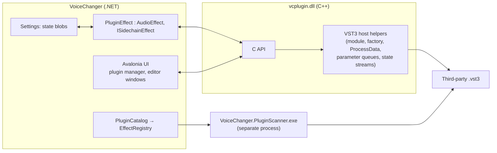

# Spec: hosting third-party VST3 plugins

Status: proposal · Scope: Windows, effect plugins · Last updated: 2026-10-27

## 1. Summary

Let people use the VST3 effect plugins they already own inside VoiceChanger: as an effect in the effect
chain and as a node in the node editor, with the plugin's own window, saved settings, and correct
delay compensation.

The plan has five parts:

- **Native bridge:** a small C++ library built on the VST3 SDK (MIT-licensed since 3.8), exposing a
  narrow C API that .NET calls through P/Invoke.
- **Effect wrapper:** a `PluginEffect` class makes each plugin a normal `AudioEffect`, so the chain,
  the node editor, presets, settings and latency handling all work without special cases.
- **Out-of-process scanning:** plugins are scanned in a separate process so a crashing plugin can't
  take the app down.
- **Phase one:** plugins run inside the app process, with a crash guard.
- **Phase two:** running each plugin in its own process for full isolation.

## 2. Goals and non-goals

**Goals**

- Load VST3 **effect** plugins (category `Fx`) on Windows x64, and on Windows ARM64 when the plugin
  itself is built for ARM64.
- Offer every plugin in **Add effect** (chain) and **Add node** (node editor).
- Show the plugin's own editor in a window. When a plugin has no editor, show its parameters with the
  usual sliders.
- Save and restore each plugin's complete state with the rest of the settings, including the node
  graph.
- Report plugin latency, so the graph's latency figure and the Synchronizer node stay correct.
- Map a plugin's side-chain input bus (vocoders, ducking compressors) to the node's second socket. The
  `ISidechainEffect` mechanism the Vocoder uses already supports this.
- Keep the audio thread real-time safe, and survive common plugin crashes without losing the user's
  session.

**Non-goals (for now)**

- **VST2:** its SDK is no longer licensed to new developers, and VST2 hosting still needs the separate
  VST2 agreement.
- **Instruments (VSTi) and MIDI:** VoiceChanger has no MIDI path.
- **AU:** macOS only. **CLAP:** a good candidate later (section 11).
- **32-bit plugins:** these need the out-of-process host from phase two.
- **Automation lanes and parameter modulation from other nodes:** possible later.

## 3. Where VoiceChanger is today

The existing design means a plugin mostly needs to look like any other effect:

| Existing piece | What it gives plugin hosting |
| --- | --- |
| `AudioEffect` (in-place, interleaved float, `Prepare` / `Process` / `Reset`) | The contract a plugin wrapper implements |
| `EffectParameter` (ranges, formatting, availability, change events from any thread) | Generic sliders for plugin parameters |
| `EffectRegistry` → `NodeRegistry` (one node per registered effect) | Registering a plugin as an effect makes it a node automatically |
| `EffectChain` (bypass cross-fade, block size ≤ 1024 frames) | Bypass and block-size limits for free |
| `ISidechainEffect` + `EffectNode` second socket | Side-chain buses map onto existing UI |
| `GraphPlan` reads every node's `LatencyFrames` each block | Plugin latency changes are picked up live; the Synchronizer compensates |
| `EffectSettings` (type id + parameter values) | Needs one addition: an opaque state blob |

There are constraints. Mono or stereo processing is chosen by the user. The sample rate is the master
output's, and it changes on restart. Blocks never exceed 1024 frames. The audio thread must not
allocate, lock or block.

## 4. Choosing how to host

| Option | Pros | Cons |
| --- | --- | --- |
| **A. C++ bridge on the VST3 SDK, C API, P/Invoke** (recommended) | Uses Steinberg's own host helpers: module loading, parameter-change queues, `ProcessData`, state streams. Narrow, testable interface. SDK is MIT since 3.8 (Oct 2025). | Needs a native build (CMake) in CI and per-architecture binaries. |
| B. Call VST3 COM-style vtables directly from C# | No native code | VST3 is C++ interfaces with ref-counting, `FUnknown::queryInterface`, and many structs to marshal. Fragile and a lot of code. |
| C. Use JUCE as the host layer | Mature, scans many formats | Large dependency; licence (AGPL or commercial); C++/JUCE build in CI; more than we need |
| D. Out-of-process host from day one | Plugin crashes can't affect the app | Inter-process audio exchange, process lifecycle, editor windows from another process. Roughly double the work for phase one. |

**Decision:** A, built so the bridge can later run inside a helper process (D) without changing the
.NET side. Everything after the C API is the same either way.

## 5. Architecture



### 5.1 Native bridge (`vcplugin.dll`)

C++17, CMake, statically linked against the VST3 SDK's hosting sources. It is built for `win-x64` and
`win-arm64` and shipped next to the app. A single-file publish already extracts native libraries.

The bridge handles all VST3 specifics:

- loading modules (`VST3::Hosting::Module`) and creating the component and its edit controller;
- connecting them with `IConnectionPoint`;
- setting up buses for mono or stereo, plus an optional auxiliary input for the side-chain;
- `setupProcessing` with 32-bit float and a maximum block of 1024 frames;
- activating and deactivating, and processing with input parameter-change queues;
- reading and writing state through `IBStream`;
- the editor (`IPlugView` attached to an `HWND`);
- host callbacks (`IComponentHandler`, `restartComponent`).

The C API is deliberately small, with only plain types crossing the boundary:

```c
typedef struct vc_plugin vc_plugin;

int  vc_scan_module(const wchar_t* path, vc_class_info* out, int capacity);   // used by the scanner
vc_plugin* vc_open(const wchar_t* path, const char* class_id, vc_host_callbacks* callbacks, vc_error* error);
int  vc_setup(vc_plugin*, double sample_rate, int max_frames, int channels, int sidechain_channels);
void vc_set_active(vc_plugin*, int active);
void vc_process(vc_plugin*, const float* const* inputs, const float* const* sidechain,
                float* const* outputs, int frames,
                const vc_param_change* changes, int change_count);            // audio thread
int  vc_latency(vc_plugin*);
int  vc_param_count(vc_plugin*);
int  vc_param_info(vc_plugin*, int index, vc_param_info* out);                  // id, name, units, steps, flags, default
double vc_param_get(vc_plugin*, unsigned id);                                   // normalised 0–1
int  vc_param_format(vc_plugin*, unsigned id, double value, wchar_t* text, int capacity);
int  vc_state_get(vc_plugin*, uint8_t* buffer, int capacity);                   // component + controller
int  vc_state_set(vc_plugin*, const uint8_t* buffer, int length);
int  vc_editor_open(vc_plugin*, void* hwnd, int* width, int* height);
void vc_editor_resized(vc_plugin*, int width, int height, float scale);
void vc_editor_close(vc_plugin*);
void vc_close(vc_plugin*);
```

`vc_host_callbacks` reports three things: a parameter edited in the plugin's window (begin, perform,
end), a restart request (latency or parameter list changed), and a resize request. Every entry point
is wrapped in structured exception handling (`__try` / `__except`). A plugin that faults is marked
crashed, and from then on `vc_process` outputs silence (see section 8).

### 5.2 .NET side (`VoiceChanger.Plugins`, a new project referenced by the app)

- **`PluginCatalog`:**
  - Folders: the standard VST3 folders (`%CommonProgramFiles%\VST3`,
    `%LocalAppData%\Programs\Common\VST3`) plus folders the user adds.
  - Scanning: runs the scanner, and caches results in `plugins.json` next to `settings.json`. Each
    entry holds path, file size and modified time, class id, name, vendor, version, subcategories and
    bus layout.
  - Registration: registers one `EffectDescriptor` per effect class, with type id `vst3:{classId}`.
    Because `NodeRegistry` builds on `EffectRegistry`, these become nodes automatically.
- **`PluginEffect : AudioEffect, ISidechainEffect`:**
  - *Parameters:* one `EffectParameter` per plugin parameter. Each is continuous from 0 to 1, or an
    integer when the plugin reports steps. It uses the plugin's own text (`vc_param_format`) as its
    formatter and hides read-only and hidden parameters.
  - *Edits from VoiceChanger:* when an `EffectParameter` changes (from any thread), the change goes
    into a lock-free single-producer, single-consumer queue. The audio thread drains it into the
    `vc_param_change` array for the next `vc_process`.
  - *Edits from the plugin's window:* the change arrives on the UI thread, which updates the
    `EffectParameter` with an origin flag. That flag stops the edit being echoed back to the plugin.
  - *Processing:* deinterleaves into buffers allocated in `OnPrepare`. In mono mode, plugins that only
    offer stereo buses get the signal on both channels and the result folded back to mono.
  - `LatencyFrames` returns the value cached from `vc_latency`, refreshed when the plugin asks for a
    restart. `InputName` and `SidechainName` come from the plugin's bus names.
- **Settings:** `EffectSettings` and `NodeSettings` gain `string? State` (base64). It is written for
  plugin effects and is authoritative on load. Parameter values are kept as well, so the summary text
  and presets still work.
- **`MissingPluginEffect`:** used when a saved plugin is not installed. It passes audio through, shows
  "Missing: {name} ({vendor})", and keeps the saved state so the next save does not lose it.
- **UI:**
  - **Add effect** and **Add node** gain a *Plugins* group, by vendor.
  - A *Plugin manager* dialog lists folders, scan and rescan, plugins that failed to scan, and the
    block list.
  - Plugin cards and the node inspector show **Open plugin window**.
  - The editor is a separate top-level Win32 window owned by the main window. That is simpler than
    embedding it in the Avalonia layout through `NativeControlHost`, and it is how most hosts work. It
    follows the plugin's size requests and the monitor's DPI (`IPlugViewContentScaleSupport`).

## 6. Threading and real-time rules

| Call | Thread | Notes |
| --- | --- | --- |
| `vc_open`, `vc_setup`, `vc_set_active`, `vc_close` | UI thread, while the effect is not processed | `AudioEffect.Prepare` already runs only while stopped. A sample-rate or channel change is handled by deactivate → setup → activate. |
| `vc_process` | Audio thread | No allocation: buffers and the parameter-change array are preallocated. |
| Parameter edits | Any thread → queue → audio thread | Drained at the start of the next block. |
| `vc_state_get` / `vc_state_set` | UI thread | VST3 allows this while processing. On load we restore state before activating. |
| Editor and host callbacks | UI thread | Latency-change callbacks only refresh the cached `LatencyFrames`. |

## 7. Scanning

1. Collect the `.vst3` bundles (folders) and single files under the plugin folders.
2. If a bundle has `Contents/Resources/moduleinfo.json`, read its classes without loading any code.
   This is fast and safe, but the file is optional and some plugins don't ship it.
3. Otherwise run `VoiceChanger.PluginScanner.exe <path>`, which loads the module, lists its factory
   classes and prints JSON. The scanner has a 10-second timeout. A crash or timeout puts the plugin on
   the block list, with the reason, and it is shown in the plugin manager with a *Try again* button.
4. Rescan a plugin only when its path, size or modified time changed.

## 8. Stability

- **Phase 1 (in-process):**
  - Faults inside plugin code are caught by the bridge's exception handlers. The effect turns into a
    pass-through, shows "{name} stopped working", and the plugin goes on the block list for the next
    start.
  - Heap corruption and deadlocks can't be caught this way, so this is a mitigation, not isolation.
  - The audio engine's existing fault path (`Faulted` → stop and show the error) covers what remains.
- **Phase 2 (out-of-process):**
  - One `VoiceChanger.PluginHost.exe` per plugin instance, or per group of trusted plugins, hosts the
    same bridge.
  - Audio is exchanged through shared memory with a semaphore handshake inside the same callback,
    which adds no buffering latency, only about 20–100 µs of context switching per block.
  - A dead host restarts and its last saved state is restored.
  - This also makes 32-bit plugins and x64 plugins on ARM64 Windows possible, using an x64 host under
    emulation.

## 9. Licensing and branding

- **VST3 SDK:** MIT since version 3.8.0 (October 2025); before that it was dual-licensed GPLv3 or
  proprietary. Pin the SDK version and keep its licence text in the third-party notices.
- **VST2:** not included; it would need Steinberg's separate VST2 licence.
- **Trademarks:** the "VST" name and logo are Steinberg trademarks. Use the name only descriptively
  ("supports VST3 plugins"), and only use the logo under Steinberg's usage guidelines.
- **Third-party plugins:** each comes under its own licence. We never ship or redistribute any.

## 10. Testing

- **Test plugins:** build two tiny plugins from the SDK in CI:
  - *gain + delay*, with a fixed reported latency and one stepped parameter;
  - *ducker*, with an auxiliary input bus and a parameter that changes its latency.
- **Core tests (Windows job):**
  - load and unload; process silence and noise;
  - parameter round trip, including the plugin's own value text;
  - state round trip through the settings;
  - latency reaching `GraphPlan.LatencyFrames()`, and the Synchronizer aligning a plugin path with a
    direct path;
  - side-chain routing through the node's second socket;
  - mono mode with a stereo-only plugin;
  - sample-rate change on restart;
  - the existing "survives noise and parameter changes" stress test, run against the test plugins.
- **Fault tests:** a deliberately crashing test plugin. The scanner must block it, and a crash during
  processing must not stop the other effects.
- **UI tests (headless):**
  - plugin entries appear in *Add effect* and *Add node*;
  - generic parameter sliders work;
  - a missing plugin shows a placeholder and keeps its state.
  - Native editor windows are covered by a manual test checklist, since they can't render headless.
- **Performance:** wrapper overhead (deinterleaving, queues, P/Invoke) should stay under 1% of one core
  per instance at 48 kHz stereo with 480-frame blocks.

## 11. Later: CLAP

CLAP is an open, MIT-licensed plugin standard with a plain C interface. It is easier to host than VST3
and is supported by a growing number of plugins. With the catalogue, `PluginEffect` and settings
written against an internal `IPluginInstance` interface, CLAP needs only a second bridge (or direct
P/Invoke, since the API is plain C). Type ids would be `clap:{id}`.

## 12. Milestones

| Milestone | Contents | Estimate |
| --- | --- | --- |
| M1: plugins play | Native bridge (load, setup, process, parameters, latency, state). `PluginEffect` with generic sliders. Catalogue with `moduleinfo.json` and scanner. Settings state and the missing-plugin placeholder. Test plugins and core tests. | 2 weeks |
| M2: plugins feel native | Editor windows (resize, DPI). Side-chain sockets. Plugin manager (folders, rescan, block list). Factory presets in the preset menu. | 1–1.5 weeks |
| M3: stability | Out-of-process host with shared-memory audio, crash recovery and restart, ARM64/x64 bridging | 2 weeks |
| M4 (optional) | CLAP | 1 week |

## 13. Open questions

1. Is in-process hosting (with the crash guard) acceptable for a first release, or should we wait for
   M3?
2. Plugins can have hundreds of parameters. Should the generic view show all of them with a search
   box, or only the ones the plugin marks as automatable?
3. When processing in mono, should stereo-only plugins be refused, or folded down silently as
   proposed?
4. Should plugin windows stay open across Stop and Start, which would mean re-attaching after
   re-activation?
5. Should plugin parameters appear in the node's one-line summary on the canvas? Probably only the
   preset name.

## 14. Risks

- **Third-party code runs in our process** (until M3). A misbehaving plugin can crash or glitch the
  whole app. Mitigated by out-of-process scanning, the crash guard and the block list.
- **Plugins that are not real-time safe** (allocating or locking in `process`) can cause dropouts. We
  can measure and warn, but not fix them.
- **Editor quirks:** DPI scaling, resizing, and plugins that assume a particular window parent.
  Hosting in a separate top-level window avoids most layout issues.
- **Native build in CI:** adds a CMake step and per-architecture artifacts to the Windows job.
